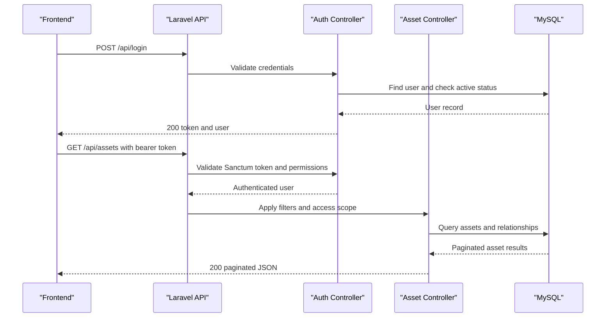

# API & Service Communication Contracts

The backend exposes 44 registered API routes under `/api`, using synchronous JSON HTTP requests with CSV and file transfer endpoints. Requests are handled by one Laravel API service and persisted directly through Eloquent; no inter-service HTTP or message-broker communication was identified.

## Service Catalog

| Service | Port | Category | Purpose |
| --- | --- | --- | --- |
| `app` (backend API) | 8000 host / 80 container | API Layer | Serves the REST API and frontend assets; uses Laravel 13, Sanctum, and Spatie Permission. |
| `db` | 3306 internal | Infrastructure | MySQL persistence for the API. |
| `scheduler` | None exposed | Infrastructure | Runs Laravel scheduled work; built from the backend image. |

## API Endpoints Inventory

All paths are prefixed with `/api`. Unless noted otherwise, endpoints require Sanctum authentication.

| Service | Method | Path | Request Type | Response Type |
| --- | --- | --- | --- | --- |
| API / AuthController | POST | `/login` | JSON: email, password | Token and user payload; invalid credentials return 422 |
| API / AuthController | GET, POST | `/me`, `/logout` | Bearer token | User payload; logout returns 204 |
| API / AssetController | GET | `/me/assets` | Bearer token | Asset collection for current employee |
| API / AssetController | GET | `/assets` | Query: status, category_id, location_id, search, page | Paginated assets |
| API / AssetController | POST | `/assets` | JSON asset fields | Asset JSON (201) |
| API / AssetController | GET | `/assets/{asset}` | Path ID | Asset detail JSON |
| API / AssetController | PUT, DELETE | `/assets/{asset}` | Path ID; JSON asset fields for update | Updated asset JSON; delete returns 204 |
| API / AssetController | POST | `/assets/{asset}/assign` | JSON: employee_id or department_id; optional return date, handover flag, notes | Assignment JSON (201) |
| API / AssetController | POST | `/assets/{asset}/return` | JSON: optional condition and notes | Return JSON; 422 if no active assignment |
| API / CrudController | GET, POST, PUT, DELETE | `/{resource}`, `/{resource}/{id}` | JSON body for writes; page query for lists | Paginated or single resource JSON; delete returns 204 |
| API / CrudController | — | `/{resource}` supported values | `employees`, `departments`, `locations`, `categories`, `brands`, `suppliers`, `purchases`, `warranties` | Generic resource data |
| API / CrudController | GET, POST, PUT, DELETE | `/maintenances`, `/maintenances/{id}` | JSON body for writes; page query for lists | Paginated or single maintenance JSON; delete returns 204 |
| API / AttachmentController | POST | `/assets/{asset}/attachments`, `/purchases/{purchase}/attachments` | Multipart form, `file` field | Attachment model |
| API / AttachmentController | GET, DELETE | `/attachments/{attachment}/download`, `/attachments/{attachment}` | Path ID | File download; delete returns 204 |
| API / NotificationController | GET | `/notifications` | Query: page | Paginated notifications |
| API / NotificationController | PATCH | `/notifications/{notification}` | Path ID | No content (204) |
| API / DashboardController | GET | `/dashboard/stats` | Bearer token | JSON stats object |
| API / ActivityLogController | GET | `/activity-logs` | Query: user_id, action, from, to, page | Paginated activity logs |
| API / ReportController | GET | `/reports/assets.csv` | Bearer token | CSV file download |
| API / InventoryAuditController | GET, POST | `/inventory-audits` | JSON audit fields for create; page query for list | Paginated audits; created audit (201) |
| API / InventoryAuditController | GET, PUT, PATCH, DELETE | `/inventory-audits/{inventory_audit}` | Path ID; JSON status/notes for update | Audit JSON; delete returns 204 |
| API / InventoryAuditController | POST | `/inventory-audits/{inventory_audit}/items` | JSON array `asset_ids` | Audit with items (201) |
| API / InventoryAuditController | PATCH | `/inventory-audit-items/{inventory_audit_item}` | JSON status and optional actual location, condition, notes | Updated audit item JSON |
| API / UserController | GET, POST, PUT, PATCH, DELETE | `/users`, `/users/{user}` | JSON user fields; page query for list | Paginated or single user JSON; delete deactivates and returns 204 |
| API / UserController | POST | `/users/{user}/role`, `/users/{user}/password` | JSON role or password | Updated user role; password reset returns 204 |
| API / UserController | GET | `/roles`, `/permissions` | Bearer token | Role and permission collections |
| API / UserController | PUT | `/roles/{role}/permissions` | JSON array `permissions` | Updated role JSON |

## Management & Observability Endpoints

| Service | Endpoint | Custom Metrics |
| --- | --- | --- |
| Backend API | `GET /up` | None identified |

No custom metrics, Prometheus endpoint, or metrics registration was identified.

## DTOs & Contracts

No dedicated request/response DTO classes or OpenAPI/Swagger, protobuf, or GraphQL definitions were found. Controllers validate Laravel request data and return arrays, Eloquent models, paginator payloads, or streamed files. `Asset`, `User`, `InventoryAudit`, and related Eloquent models are service-level response models, not gateway aggregation DTOs. The login response is a composed object containing a Sanctum token and user data with role names. JSON serialization follows Laravel's model serialization; no custom API serializer was identified.

## Communication Patterns

- The frontend calls the API synchronously over HTTP. Controllers call application models directly, and Eloquent accesses MySQL; no separate gateway or inter-service REST client was identified.
- Scheduled work runs in a Laravel scheduler container. No message broker or asynchronous application event transport was identified; user notifications are stored using Laravel's notification system.
- No circuit breaker, retry policy, bulkhead, or explicit API timeout configuration was identified.
- Services use Docker Compose service names for internal database connectivity; no service-discovery system or client-side load balancing was identified.
- Authentication uses Sanctum bearer tokens. Role and permission checks are applied to protected route groups. CORS allows `http://localhost:5173`; the local compose URL uses HTTP, and no application-level TLS configuration was identified.
- The API route set has no version prefix or other explicit API versioning scheme.

## Service Technology Matrix

| Service | Web | Data Access | Discovery | Gateway | Health | Cache | Metrics |
| --- | --- | --- | --- | --- | --- | --- | --- |
| Backend API | Laravel HTTP | Eloquent / MySQL | None | None | Laravel `/up` | No API cache identified | None identified |
| Database | — | MySQL 8.4 | Docker Compose DNS | — | Compose health check | — | — |
| Scheduler | Laravel scheduler | Eloquent / MySQL | Docker Compose DNS | — | None identified | — | — |

## Service Communication Sequence

<!-- mermaid-checked: every participant uses `participant Id as "Label"`, no \n in aliases/messages/notes, every alt/opt/loop closed by end, no `:` inside any alias -->

